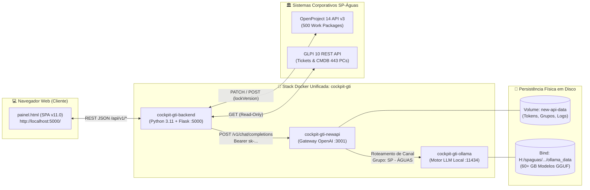

# 🌊 Cockpit GTI 360° — Plataforma Integrada de Governança Digital, Operações & Inteligência Artificial

[](#)
[](https://www.spaguas.sp.gov.br/site/)
[](#)
[](#)
[](#)
[](#)

> **Centro de Comando Executivo, Instrução Processual SEI!, Gestão de Portfólio OpenProject, Sustentação ITSM/CMDB GLPI 10, Rituais Ágeis e Orquestração de Múltiplas IAs Locais da Gerência de Tecnologia da Informação (SA-GTI) da Agência de Águas do Estado de São Paulo (SP-Águas).**

---

## 🏛️ Identificação Institucional

| Atributo | Especificação Oficial |
| :--- | :--- |
| **Órgão / Autarquia** | Agência de Águas do Estado de São Paulo (**SP-Águas**) |
| **Superintendência / Unidade** | Superintendência de Administração — Gerência de Tecnologia da Informação (**SA-GTI**) |
| **Divisões Técnicas Atendidas** | Divisão de Infraestrutura (**SA-GTI-DIF**) & Divisão de Governança Digital e Sistemas (**SA-GTI-DGD**) |
| **Idealização, Arquitetura & Governança** | **Luiz Antonio Seixeiro** — Gestor de Projetos Sênior / Governança de TIC (SA-GTI) |
| **Repositório Oficial** | [github.com/LUIZ-SEIXEIRO/Cockpit_GTI](https://github.com/LUIZ-SEIXEIRO/Cockpit_GTI) |
| **Versão de Produção** | **v11.0.0 Oficial** — Arquitetura SPA Dual-Theme + Stack Docker Unificada (`cockpit-gti`) |

---

## 📚 Central de Documentação Oficial do Projeto

Este repositório conta com documentação institucional extensiva, didática e estruturada para atender tanto equipes técnicas de desenvolvimento e infraestrutura quanto gestores, analistas e áreas demandantes:

1. 📘 **[Manual do Usuário — Operacional, Tático \& Executivo (docs/MANUAL\_DO\_USUARIO.md)](docs/MANUAL_DO_USUARIO.md)**  
   *Guia didático completo cobrindo todos os 4 Eixos Mestres, 15 Abas, 23 Sub-abas, perfis de acesso RBAC, roteiros passo a passo do dia a dia e glossário técnico-administrativo.*
2. ⚙️ **[Documentação Técnica, Arquitetura \& Engenharia de Integrações (docs/DOCUMENTACAO\_TECNICA.md)](docs/DOCUMENTACAO_TECNICA.md)**  
   *Especificação profunda da topologia Docker, mapeamento de IDs DOM e funções JavaScript, catálogo da API REST (`/api/v1/`), concorrência otimista no OpenProject v3, conector GLPI 10, cálculo de Aging Líquido e Troubleshooting.*
3. 🐙 **[Guia de DevOps, Docker Desktop \& Governança Git (docs/GUIA\_PUBLICACAO\_GITHUB.md)](docs/GUIA_PUBLICACAO_GITHUB.md)**  
   *Manual de implantação do zero via Docker Desktop, administração de modelos locais no Ollama, configuração de canais/tokens no New API, gates de aceite, implantação gradual, rollback e rotina de Backup 3-2-1-1-0.*

---

## 🎯 1. Visão Geral e Propósito Estratégico

O **Cockpit GTI 360°** nasceu para solucionar a dispersão informacional enfrentada na gestão pública de Tecnologia da Informação, unificando em uma única interface *Single-Page Application (SPA)* de altíssimo desempenho os **5 Pilares Operacionais e Estratégicos da SA-GTI**:

1. **📂 Governança Processual SEI! (179 Processos Mapeados):**
   * Classificação nos **18 Buckets Canônicos (A-001 a A-018)**, separação automática entre **Esteira de Contratação (55)**, **Rotina Operacional (93)** e **Portfólio Estratégico (31)**.
   * Cálculo automatizado do **Aging Líquido** mediante aplicação da **Regra Jurídica dos "Poréns"**, descontando períodos de suspensão externa (Consultoria Jurídica, fornecedores, órgãos externos) para aferir com justiça a eficiência real da equipe técnica.
2. **🏗️ Gestão de Portfólio e Projetos (OpenProject 14 — API v3):**
   * Monitoramento integrado de **500 Pacotes de Trabalho (*Work Packages*)** distribuídos em **29 Projetos Oficiais**, com recortes dedicados para as *Tracks* da SA-GTI (97 pacotes) e para os **5 Eixos Estratégicos, 35 Iniciativas e 8 KPIs do PDTIC 2027–2030**.
   * Canal de escrita bidirecional controlado com trava de segurança (*Human-in-the-Loop*) e controle de versão (`lockVersion`).
3. **🎫 Sustentação ITSM e Inventário CMDB (GLPI 10):**
   * Acompanhamento da fila operacional de chamados técnicos não solucionados, controle de SLAs e espelhamento fiel do **Parque de Ativos CMDB** (**443 Computadores**, **436 Monitores**, **30 Impressoras** e **~8.900 Softwares instalados**).
4. **🤝 Rituais Ágeis e Sala de Guerra (War Room & Kanban):**
   * Condução da **Daily Scrum de 15 minutos** com cronômetro regressivo integrado, pauta alimentada em tempo real por itens do SEI, OpenProject e GLPI, mural de *post-its* de impedimentos, quadro **Kanban Drag-and-Drop** e emissão com 1 clique da **Ata Administrativa Oficial em PDF A4**.
5. **🤖 Pool Multi-IA 100% Local (Soberania de Dados & LGPD):**
   * Orquestração de múltiplos Grandes Modelos de Linguagem (*Qwen 2.5 14B/7B*, *Qwen 2.5 Coder 7B/1.5B*, *Llama 3.2 1B* e *DeepSeek R1 14B*) rodando localmente via **New API (`:3001`)** e **Ollama (`:11434`)** para redigir minutas de **DFD, ETP, TR, Pareceres SEI e Dossiês Técnicos** sem enviar dados públicos sensíveis para nuvens externas.

---

## 🗺️ 2. Arquitetura Completa de Navegação (Os 4 Eixos, 15 Abas e 23 Sub-abas)

A interface do Cockpit GTI organiza todas as funcionalidades em **4 Eixos Mestres** na barra lateral esquerda, desdobrados em **Sub-abas Superiores Contextuais**:

```mermaid
graph TD
    ROOT["🌊 COCKPIT GTI 360° (SPA painel.html)"] --> E1["1. 📺 EIXO 1: Cockpit (Gestão à Vista 360°)"]
    ROOT --> E2["2. 💼 EIXO 2: Mesa de Trabalho (Operação, SEI & IA)"]
    ROOT --> E3["3. 🤝 EIXO 3: War Room & Rituais Ágeis"]
    ROOT --> E4["4. ⚙️ EIXO 4: Configurações & Governança Técnica"]

    %% Eixo 1
    E1 --> E1_1["📂 1.1 Acervo SEI 360°<br/>(Consolidado | Esteira | Rotina | Portfólio | Faróis | Relatório)"]
    E1 --> E1_2["🏗️ 1.2 Portfólio OpenProject<br/>(Todos 500 WPs | Recorte SA-GTI 97 | PDTIC & KPIs | Relatório)"]
    E1 --> E1_3["🎫 1.3 Atendimento GLPI 10<br/>(Fila Operacional ITSM | Parque CMDB 443 PCs | Relatório)"]
    E1 --> E1_4["⚖️ 1.4 Auditoria TCE-SP & Súmula 269<br/>(Conformidade 88.5% | Matriz de Riscos R01-R12 | IMR)"]

    %% Eixo 2
    E2 --> E2_1["🖥️ 2.1 Mesa de Trabalho Única<br/>(Minha Custódia | Fixados ⭐ | Pacotes OP | Chamados GLPI)"]
    E2 --> E2_2["📂 2.2 Acervo SEI Completo<br/>(9 Filtros Multicritério + Exportação CSV)"]
    E2 --> E2_3["🤖 2.3 Assistente IA 360°<br/>(Atalhos DFD/ETP/TR + Escrita Controlada OpenProject)"]
    E2 --> E2_4["📚 2.4 Cadernos & Toolkits<br/>(29 Modelos Homologados Lei 14.133 & Normas)"]
    E2 --> E2_5["📊 2.5 Matrizes RACI<br/>(Governança de Papéis DIF & DGD)"]
    E2 --> E2_6["📑 2.6 Relatórios Daily & Sprints<br/>(Histórico Auditável & Emissão PDF A4)"]
    E2 --> E2_7["🗂️ 2.7 Drive Contexto IA<br/>(Base Documental RAG em PDF)"]

    %% Eixo 3
    E3 --> E3_1["👥 3.1 War Room: Daily & Rituais<br/>(Timebox 15m | Pauta SEI/OP/GLPI | Post-its | Ata PDF)"]
    E3 --> E3_2["🏃 3.2 Gestão Ágil & Sprints<br/>(Quadro Kanban Interativo Drag-and-Drop)"]

    %% Eixo 4
    E4 --> E4_1["👥 4.1 Gestão de Usuários & Múltiplos Perfis"]
    E4 --> E4_2["🛡️ 4.2 Matriz de Permissões RBAC"]
    E4 --> E4_3["⚖️ 4.3 Parâmetros de Aging, Poréns & Sprints"]
    E4 --> E4_4["🔌 4.4 Conectores & Varredura (11 Motores)"]
    E4 --> E4_5["🤖 4.5 Pool Multi-IA & Teste de Agentes"]
    E4 --> E4_6["💾 4.6 Backup, Resiliência & DRP (3-2-1-1-0)"]
    E4 --> E4_7["📖 4.7 Documentação Oficial Integrada"]
```



### Resumo Funcional de Todos os Módulos da Plataforma:

| Eixo | Aba Superior | Sub-abas / Modos Internos | Objetivo e Entregas Principais |
| :--- | :--- | :--- | :--- |
| **1. 📺 Cockpit** | **📂 Acervo SEI (360°)** | `Consolidado (179)` • `Esteira (55)` • `Rotina (93)` • `Portfólio (31)` • `Faróis & Gargalos (87)` • `Relatório` | Monitoramento executivo dos 4 faróis de criticidade, gráficos por bucket/responsável e separação entre Custódia Interna e Suspensões Externas (*Poréns*). |
| **1. 📺 Cockpit** | **🏗️ Portfólio OpenProject** | `Todos (500)` • `SA-GTI Tracks (97)` • `PDTIC 2027-2030 & KPIs` • `Relatório Executivo` • `Logs Sync` | Rastreamento dos 29 projetos oficiais, acompanhamento de metas dos 5 Eixos do PDTIC e auditoria de sincronizações automáticas via API v3. |
| **1. 📺 Cockpit** | **🎫 Atendimento GLPI 10** | `Fila Operacional (ITSM)` • `Parque de Ativos (CMDB)` • `Relatório Gerencial` | Gestão da fila de chamados abertos/pendentes por SLA e visualização do inventário físico (443 PCs, 436 Monitores, 30 Impressoras e 8.9K Softwares). |
| **1. 📺 Cockpit** | **⚖️ Auditoria TCE-SP** | `Scorecards de Conformidade` • `Súmula 269 TCU` • `Matriz de Riscos R01–R12` | Prevenção de apontamentos de auditoria, vedação a pagamento por mera disponibilidade de mão de obra e monitoramento de riscos contratuais. |
| **2. 💼 Mesa** | **🖥️ Mesa de Trabalho** | `📌 Minha Custódia` • `⭐ Fixados` • `📦 Pacotes OP` • `🎫 Chamados GLPI` | Painel individual do servidor com seus processos, prazos críticos da semana, eficiência líquida (%), mural da coordenação e despacho rápido com IA. |
| **2. 💼 Mesa** | **📂 Acervo SEI (179)** | `9 Filtros Combinados` • `Busca Global` • `Exportação CSV` | Pesquisa analítica profunda por número SEI, diretoria/bacia, responsável, bucket A-001 a A-018, farol e status de "Porém". |
| **2. 💼 Mesa** | **🤖 Assistente IA** | `Seletor de Agente (IA 1 / IA 2 / IA 3)` • `Atalhos DFD, ETP, TR` • `Escrita OP` | Copiloto conversacional conectado ao contexto real dos processos SEI, gerador de minutas licitatórias e gravador de dossiês no OpenProject com confirmação humana. |
| **2. 💼 Mesa** | **📚 Cadernos & Toolkits** | `29 Modelos Homologados` • `Visualizador Integrado` • `Exportador PDF A4` | Biblioteca oficial de minutas da Lei 14.133/2021, catálogos de UST/Pontos de Função, tabelas de IMR e regimentos internos da SP-Águas. |
| **2. 💼 Mesa** | **📊 Matrizes RACI** | `Contratações TIC` • `Sustentação DIF` • `Desenvolvimento DGD` | Definição clara de quem Executa (**R**), Aprova (**A**), é Consultado (**C**) e é Informado (**I**) em cada entrega da gerência. |
| **2. 💼 Mesa** | **📑 Relatórios & Sprints** | `Atas de Daily` • `Relatórios de Sprint` • `Visualizar/Editar/PDF` | Acervo histórico de todas as reuniões realizadas, permitindo reimpressão em PDF A4 no padrão visual da SP-Águas e edição de deliberações. |
| **2. 💼 Mesa** | **🗂️ Drive Contexto IA** | `Repositório PDF RAG` • `Filtro Documental` • `Ativação de Contexto` | Base de documentos PDF (editais, contratos, decretos e normas) que enriquecem a memória técnica dos agentes de IA. |
| **3. 🤝 War Room** | **👥 War Room: Daily** | `Cronômetro 15m` • `Pauta (SEI / OP / GLPI)` • `Mural Post-its` • `Ata PDF` | Sala de guerra para condução cronometrada da Daily Scrum, registro de impedimentos/decisões e emissão imediata da Ata Administrativa em PDF. |
| **3. 🤝 War Room** | **🏃 Gestão Ágil (Kanban)** | `Backlog` • `Em Andamento (WIP)` • `Em Espera / Poréns` • `Concluído` | Quadro Kanban interativo (*drag-and-drop*) para movimentação de tarefas da Sprint semanal/quinzenal com sincronização para o OpenProject. |
| **4. ⚙️ Config** | **⚙️ Configurações (7 Abas)** | `👥 Usuários` • `🛡️ RBAC` • `⚖️ Parâmetros` • `🔌 Conectores` • `🤖 Pool IAs` • `💾 Backup` • `📖 Docs` | Administração completa de usuários, comutação de perfis RBAC, ajuste de faixas de *aging*, monitoramento de 11 motores, teste de latência das IAs e snapshots DRP. |

---

## 🤖 3. Arquitetura da Stack Docker Unificada & Pool Multi-IA

A plataforma executa de forma 100% containerizada e limpa sob um único projeto no Docker Desktop (**`cockpit-gti`**), integrando **3 serviços**:



### Calibração Oficial dos Agentes do Pool Multi-IA:

| Slot de IA | Agente Especializado | Modelos Homologados (`Ollama`) | Papel no Cockpit GTI |
| :--- | :--- | :--- | :--- |
| **Slot #1** | **IA 1 — Principal (Diálogo & Copiloto Executivo 360°)** | `qwen2.5:14b` / `qwen2.5:7b` | Parceiro executivo direto para consulta a fatos reais de processos SEI, redação de despachos, e-mails e geração de minutas de **DFD, ETP e TR**. |
| **Slot #2** | **IA 2 — Orquestração (Governança & Escrita OpenProject)** | `qwen2.5-coder:7b` | Auditoria normativa (**Lei 14.133/2021**, **Súmula 269 TCU**, **PDTIC 2027–2030**) e geração/homologação de Dossiês Técnicos gravados diretamente nos cartões do OpenProject. |
| **Slot #3** | **IA 3 — Microsserviços (Triagem Ágil & Reserva Raciocínio)** | `qwen2.5-coder:1.5b` / `llama3.2:1b` *(Reserva: `deepseek-r1:14b`)* | Triagem rápida de chamados GLPI, apoio instantâneo à pauta da Daily Scrum e *auto-failover* para análises complexas. |

---

## 🚀 4. Guia Rápido de Instalação e Execução (Docker Desktop)

### Pré-requisitos:
* **Docker Desktop** instalado e ativo (Windows 10/11 com WSL2 ou Linux);
* **Git** instalado.

### Passo a Passo no PowerShell:

```powershell
# 1. Clone o repositório oficial no disco de sua preferência (ex: H:\ ou C:\)
git clone https://github.com/LUIZ-SEIXEIRO/Cockpit_GTI.git H:\Cockpit_GTI

# 2. Acesse a pasta do projeto
Set-Location H:\Cockpit_GTI

# 3. Garanta a existência do volume de dados do New API (na primeira execução)
docker volume create new-api-data

# 4. Construa e inicie a stack unificada (Backend + New API + Ollama)
docker compose up -d --build

# 5. Confirme que os 3 containers estão ativos (Up)
docker compose ps
```

### Acessos Locais:
* **🌊 Painel Principal do Cockpit GTI:** [http://localhost:5000/](http://localhost:5000/)
* **🔑 Console de Administração New API:** [http://localhost:3001/](http://localhost:3001/)
* **🦙 API Nativa do Motor Ollama:** `http://localhost:11434/v1`

---

## 🔌 5. Referência Rápida da API REST (`/api/v1/`)

O servidor backend (`main.py` / `backend/main.py`) expõe os seguintes endpoints na porta `5000`:

| Método | Rota REST | Descrição Técnica |
| :---: | :--- | :--- |
| `GET` | `/` ou `/painel` | Serve a aplicação Single-Page Application (`painel.html`). |
| `GET` | `/api/v1/telemetria` | Verifica em tempo real via socket TCP a saúde dos 5 pilares (`mariadb`, `ollama`, `glpi`, `openproject`, `newapi`). |
| `GET` / `POST` | `/api/v1/ia/pool` | Exige autenticação (`Bearer API_TOKEN` ou `X-Cockpit-Token`); lê o pool com chaves mascaradas ou salva a configuração em `config_pool_ias.json`. |
| `POST` | `/api/v1/ia/testar_slot` | Exige autenticação e testa o slot pelo backend, que valida a allowlist do endpoint; retorna status e latência (`latenciaMs`). Não há chamada direta do navegador ao provedor. |
| `POST` | `/api/v1/ia/chat` | Exige autenticação e encaminha conversas, análises e minutas pelo gateway do backend; falha do gateway não aciona provedores alternativos no navegador. |
| `POST` | `/api/v1/openproject/sync_card` | Exige autenticação. No fluxo do painel, a gravação só é oferecida após análise consistente, prévia para revisão humana e confirmação explícita. |
| `GET` | `/api/v1/openproject/historico_agendado_v2` | Retorna o log auditável das sincronizações automáticas executadas (`registro_execucao_agendada.json`). |
| `GET` | `/api/v1/glpi/tickets` | Retorna a fila de chamados técnicos e dados do cache de produção do GLPI 10 (`glpi_producao_cache.json`). |

---

## 📂 6. Estrutura de Diretórios do Repositório

```text
Cockpit_GTI/
├── Dockerfile                             # Imagem oficial Python 3.11-slim do Backend (:5000)
├── docker-compose.yml                     # Stack unificada (cockpit-backend, new-api, ollama)
├── main.py                                # Servidor Flask principal e Proxy REST (/api/v1/*)
├── painel.html                            # Aplicação SPA Mestre (4 Eixos, 15 Abas, 23 Sub-abas)
├── requirements.txt                       # Dependências Python (Flask, requests, urllib3, PyMySQL)
├── .gitignore                             # Proteção contra arquivos temporários, .zip e logs binários
├── .dockerignore                          # Otimização de contexto de build do Docker
├── README.md                              # Documentação executiva principal do repositório
├── backend/
│   ├── main.py                            # Espelho modular do servidor Flask
│   ├── config_pool_ias.json               # Configuração persistente dos Agentes de IA
│   ├── sincronizar_openproject_backend.py # Conector e agendador OpenProject API v3
│   └── atualizar_e_reiniciar_cockpit.py   # Utilitário de atualização do serviço
├── frontend/
│   └── painel.html                        # Espelho sincronizado da interface SPA
├── data/
│   ├── processos.json                     # Base estruturada dos 179 processos SEI! da SA-GTI
│   ├── glpi_producao_cache.json           # Espelho de tickets ITSM e ativos CMDB GLPI 10
│   ├── registro_execucao_agendada.json    # Histórico de execuções do sincronizador
│   └── mapa_sei_op_manual.json            # Vínculos entre processos SEI e cards OpenProject
├── docs/
│   ├── MANUAL_DO_USUARIO.md               # Manual operacional completo (Aba por Aba)
│   ├── DOCUMENTACAO_TECNICA.md            # Especificação de arquitetura, DOM e APIs REST
│   └── GUIA_PUBLICACAO_GITHUB.md          # Guia de DevOps, Docker Desktop e Governança Git
└── scripts/
    ├── iniciar_cockpit.ps1                # Inicializador rápido para Windows PowerShell
    ├── iniciar_cockpit.bat                # Inicializador em lote para Windows
    ├── iniciar_cockpit.sh                 # Inicializador para ambientes Linux / WSL
    └── atualizar_painel_windows.ps1       # Script de sincronização local no Windows
```

---

## 🧪 Testes Automatizados e Contratos

Para executar localmente, instale as dependências e rode a suíte:

```bash
python -m pip install -r requirements.txt
python -m unittest discover -v tests
```

Os testes de contrato isolam as integrações com IA e OpenProject, validam formatos de entrada, autenticação e códigos HTTP, e verificam os gates do painel. O workflow do GitHub Actions executa a suíte em Python 3.11 e 3.12 em cada push e pull request, sem depender de serviços externos.

---

## ⚖️ 7. Conformidade Legal, Governança Pública e Segurança

* **Lei Federal nº 14.133/2021 (Nova Lei de Licitações e Contratos):** Padronização integral da fase preparatória com geração assistida de DFD, ETP, Matriz de Riscos, Pesquisa de Preços e Termo de Referência.
* **Súmula 269 do TCU:** Aferição estrita de contratações de TIC por resultados mensuráveis (UST/Pontos de Função) e níveis mínimos de serviço (IMR/SLA), vedando a remuneração por mera disponibilidade de postos.
* **Lei Geral de Proteção de Dados (LGPD — Lei nº 13.709/2018):** Processamento de linguagem natural 100% *on-premises* via containers locais (`cockpit-gti-newapi` e `cockpit-gti-ollama`), garantindo que nenhum dado processual ou pessoal saia do controle da autarquia.
* **Resiliência e Continuidade (Regra 3-2-1-1-0):** Arquitetura preparada para snapshots de estado, persistência em volumes isolados e rápida recuperação de desastres (DRP).

---

&lt;div align=&quot;center&quot;&gt;
  &lt;strong&gt;🌊 Agência de Águas do Estado de São Paulo (SP-Águas)&lt;/strong&gt;&lt;br/&gt;
  Superintendência de Administração — Gerência de Tecnologia da Informação (SA-GTI)&lt;br/&gt;
  &lt;em&gt;Desenvolvido e mantido sob coordenação de Luiz Antonio Seixeiro • 2026&lt;/em&gt;
&lt;/div&gt;